# 第一阶段手工验收截图（2026-10-21）

验收账号为 manual_a_1021、manual_b_1021，页面地址为 `http://localhost:5174`。截图对应[测试用例](test-cases.md) H01—H08，展示规则配置、校验提示、答卷提交、统计和状态检查结果。

## S01 多选条件重叠提示

原文件：屏幕截图 2026-10-21 140838.png。对应 H02。

优先级 1 为包含全部 X/Y 跳 Q5，优先级 2 为包含 X 跳 Q4。两条条件有交集，页面提示同时命中时执行较高优先级。

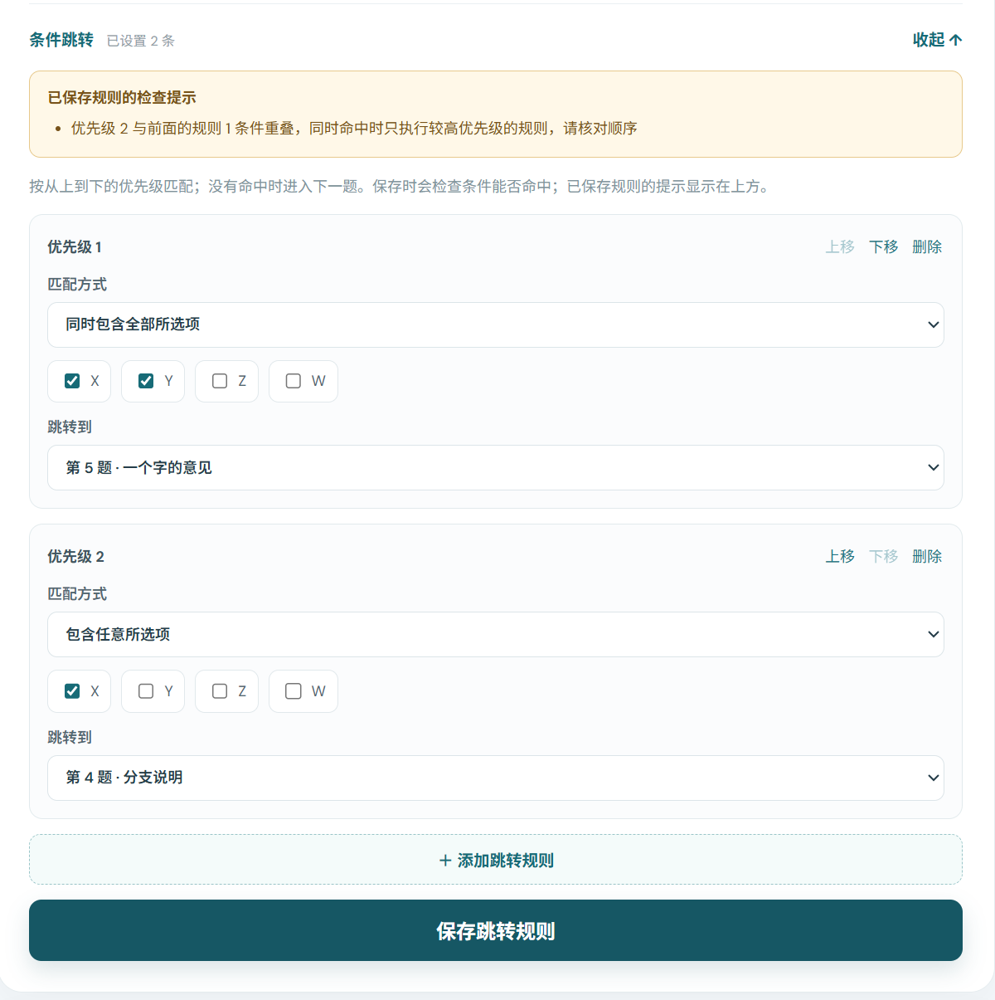

## S02 数字题规则配置

原文件：屏幕截图 2026-10-21 141351.png。对应 H02。

优先级 1 为 ≥80 跳 Q6，优先级 2 为 ≥60 跳 Q5；正常重叠允许保存，按第一命中执行。

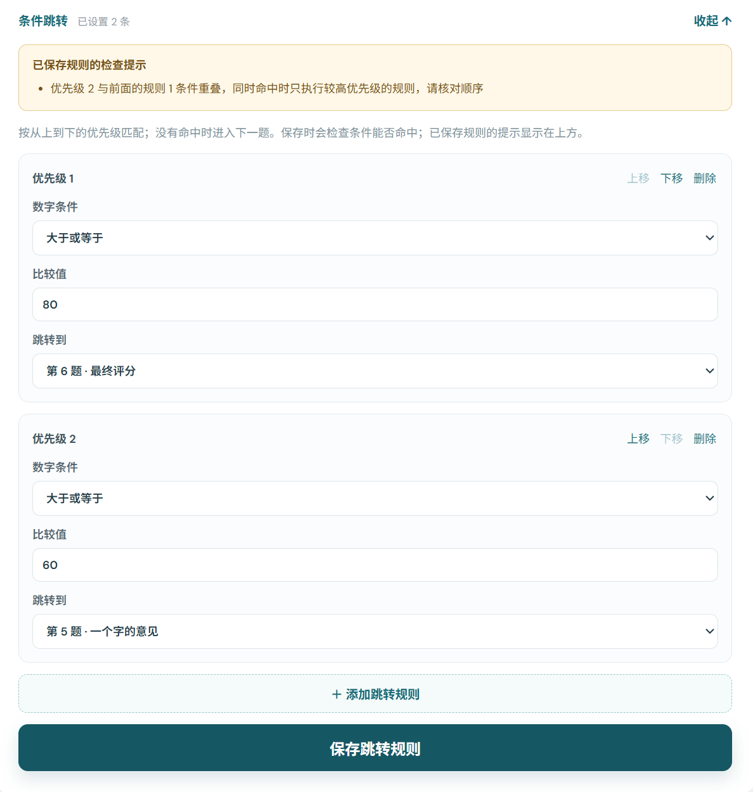

## S03 不可命中的规则被拒绝

原文件：屏幕截图 2026-10-21 141506.png。对应 H02。

第三条配置 >200，页面显示在当前题目限制下永远无法命中，拒绝保存。

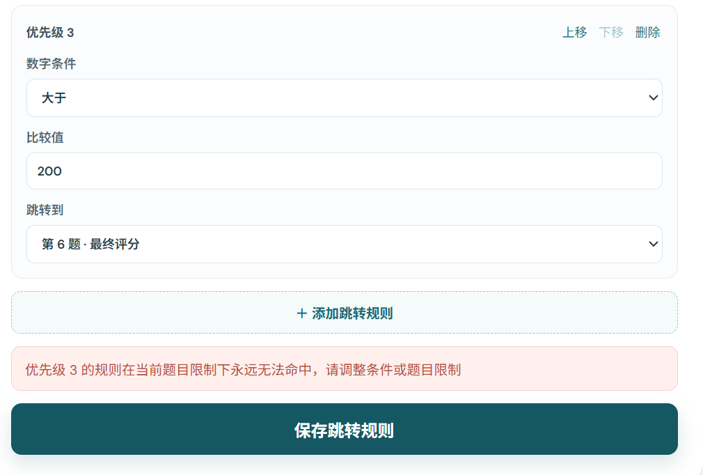

## S04 被前置规则完全覆盖

原文件：屏幕截图 2026-10-21 141548.png。对应 H02。

≥60 排在 ≥80 之前，页面提示后者被完全覆盖，执行时不会生效。该提示允许创建者保存后调整顺序。

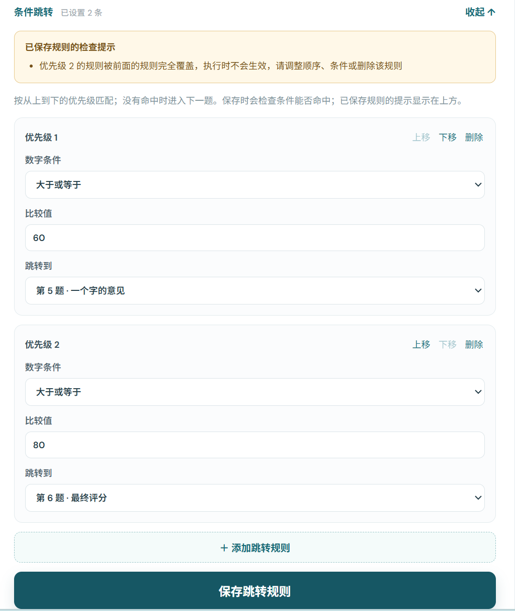

## S05 草稿链接访问

原文件：屏幕截图 2026-10-21 141651.png。对应 H03。

打开尚未发布的分享地址，页面显示“问卷未发布或不存在”。

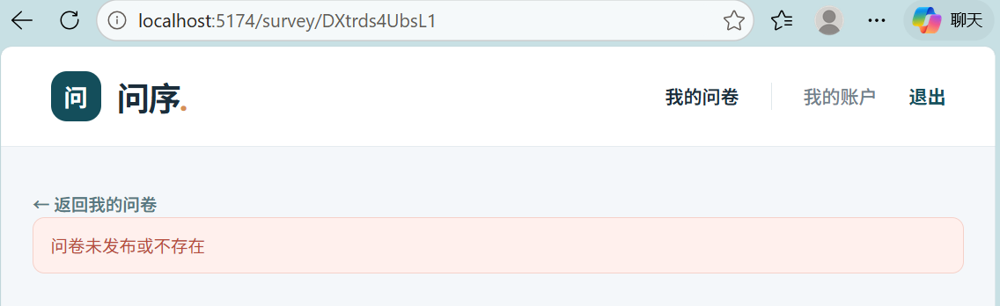

## S06 答卷提交成功

原文件：屏幕截图 2026-10-21 141956.png。对应 H01/H03/H04。

填写账号为 manual_b_1021，交互问卷显示提交成功，记录编号为 `6ad859818d6e7844ab5d4892`，并提供“再填一次”。具体答案及新路径检查结果记录于 H01/H04。

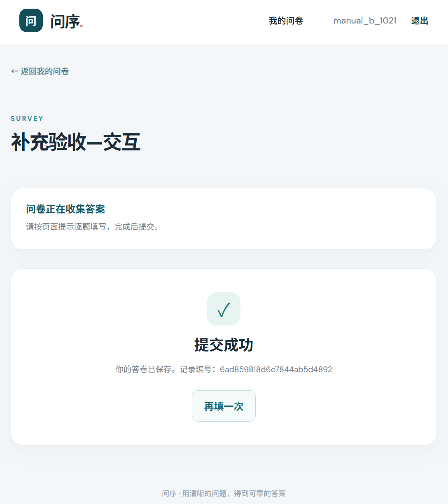

## S07 首份交互答卷统计

原文件：屏幕截图 2026-10-21 142031.png。对应 H04。

创建者 manual_a_1021 查看统计，总答卷数为 1，Q1 的 A 为 1、B/C 为 0。返回改答及旧分支检查结果见 H04。

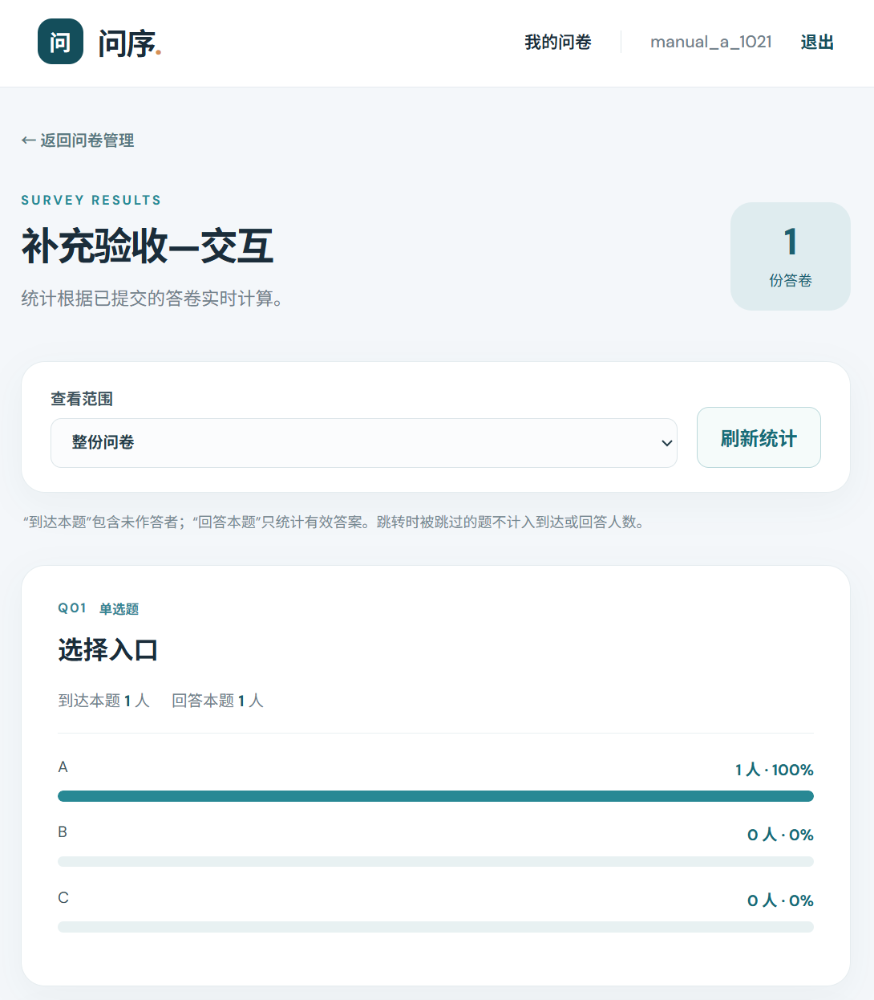

## S08 固定三份答卷与单选统计

原文件：屏幕截图 2026-10-21 142523.png。对应 H06。

统计问卷总答卷数为 3，Q1 到达和回答人数均为 3，A/B 计数为 1/2。

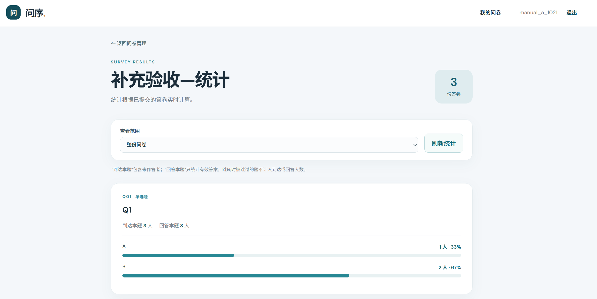

## S09 多选、文本和匿名展示

原文件：屏幕截图 2026-10-21 142536.png。对应 H06。

Q2 到达 2、回答 1，X/Y/Z 分别 1/1/0；文本题到达 3、回答 2。实名意见显示 manual_b_1021，匿名意见仅显示匿名；下方数字平均值为 15。

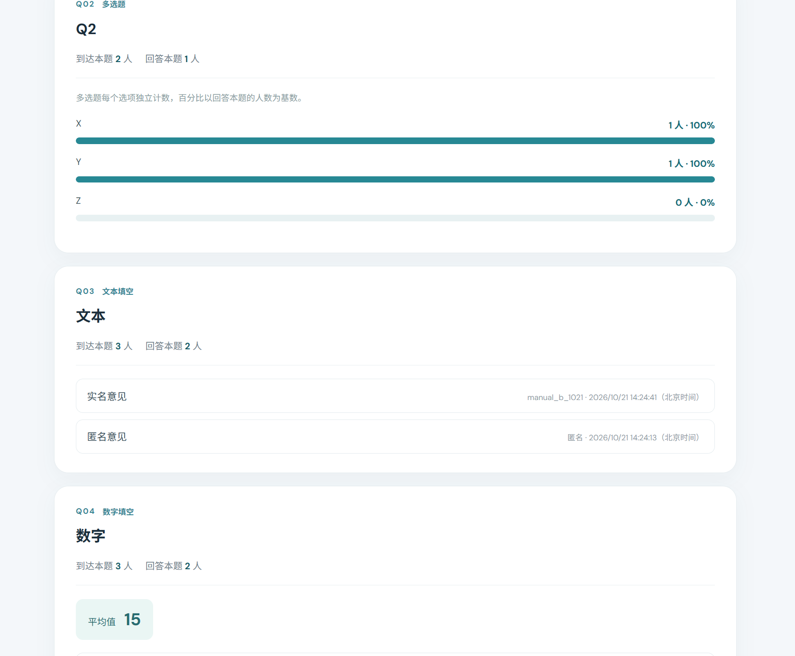

## S10 数字答案与平均值

原文件：屏幕截图 2026-10-21 142543.png。对应 H06。

数字题到达 3、回答 2，有效值 20、10，平均值 15；两份答案分别展示实名与匿名。

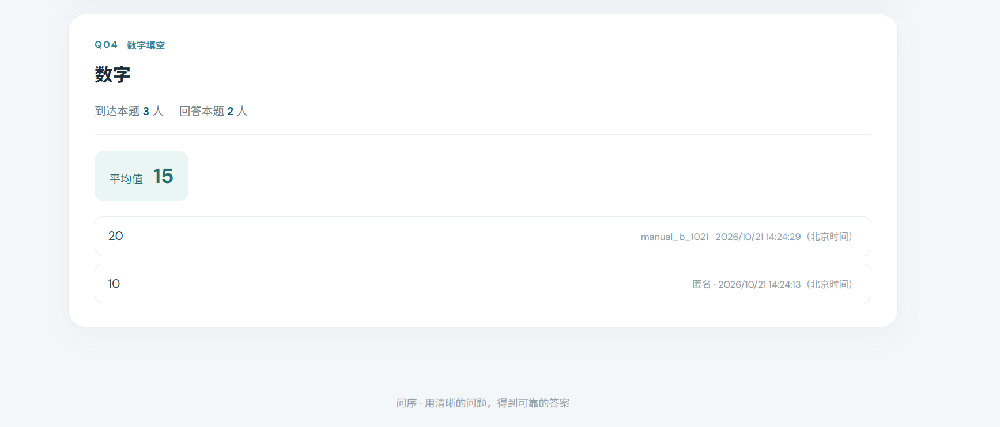

## S11 状态问卷开放

原文件：屏幕截图 2026-10-21 142652.png。对应 H07。

开放问卷可选择 A/B，页面无匿名提交开关。截图中的 Q1 为选答，本项选择 A，主要检查生命周期和填写条件。

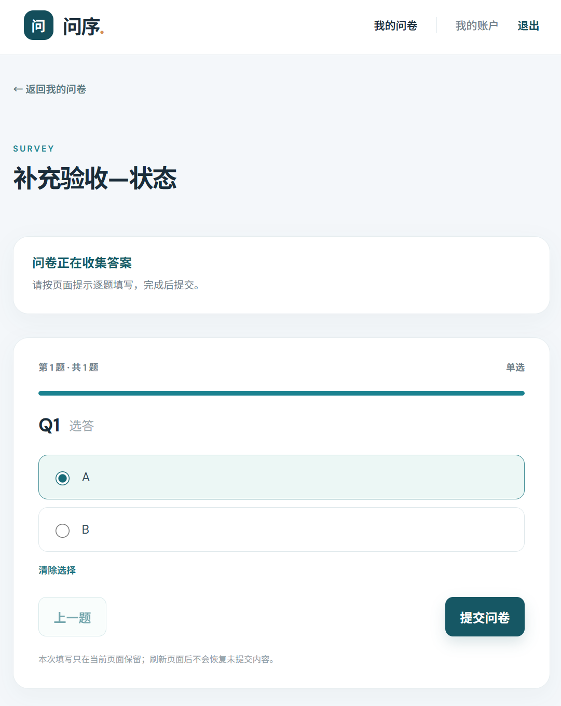

## S12 禁止重复填写

原文件：屏幕截图 2026-10-21 142716.png。对应 H07。

再次打开问卷时显示“此账号已提交；这份问卷不允许重复填写”，不提供再次填写入口。

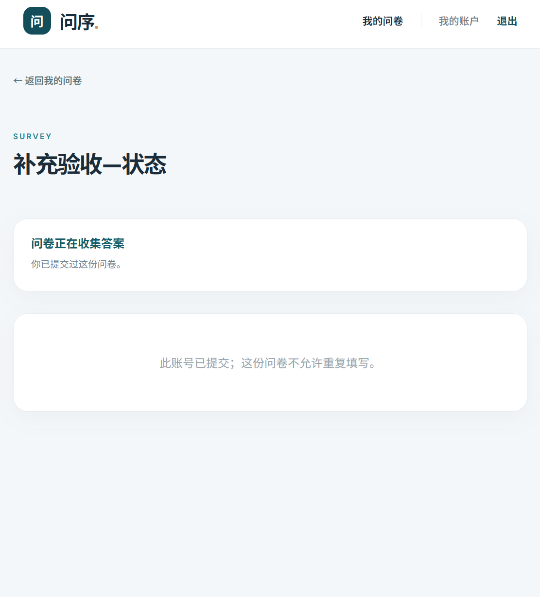

## S13 到期后拒绝旧页面提交

原文件：屏幕截图 2026-10-21 142827.png。对应 H07。

截止为北京时间 14:28:00；未刷新页面提交后显示“问卷未开放或已截止”。顶部仍显示收集状态，因为页面保持打开；本图用于证明提交时再次检查截止，不作为刷新后状态显示截图。

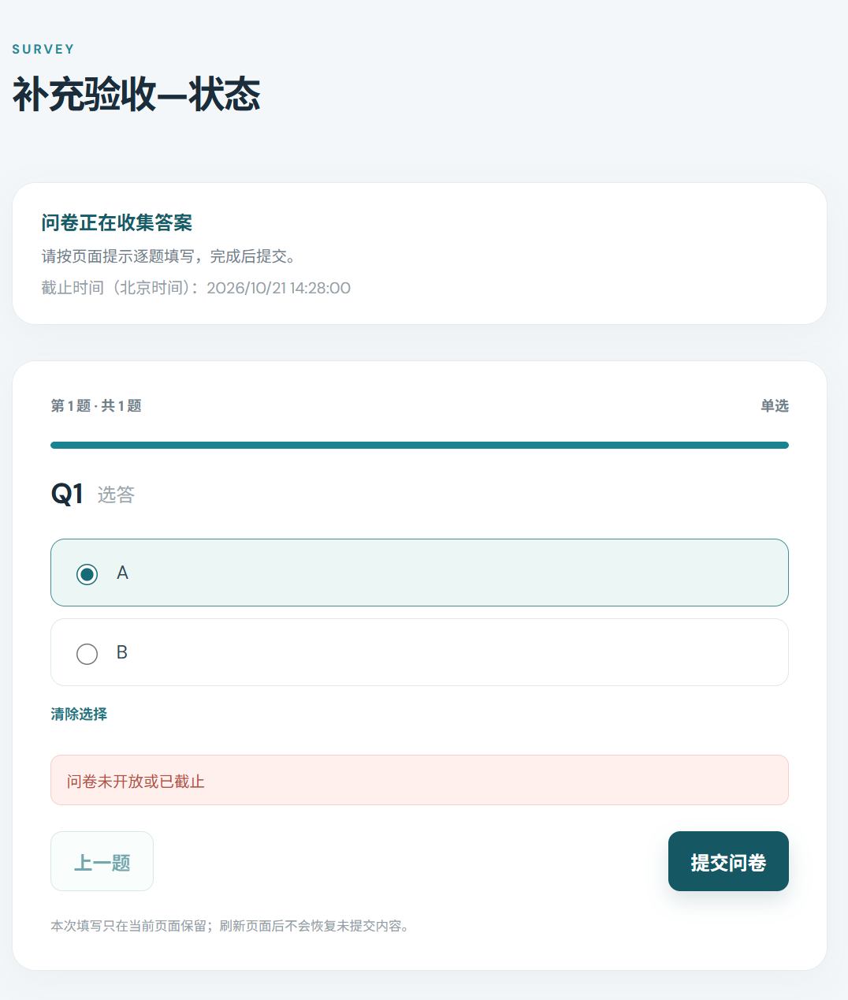
